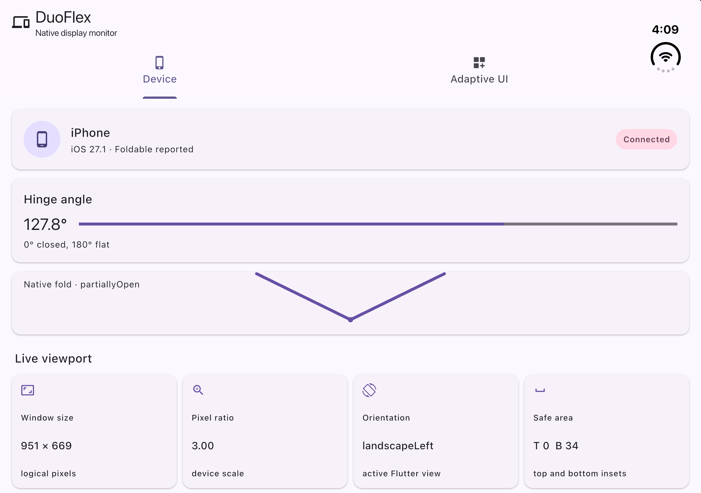
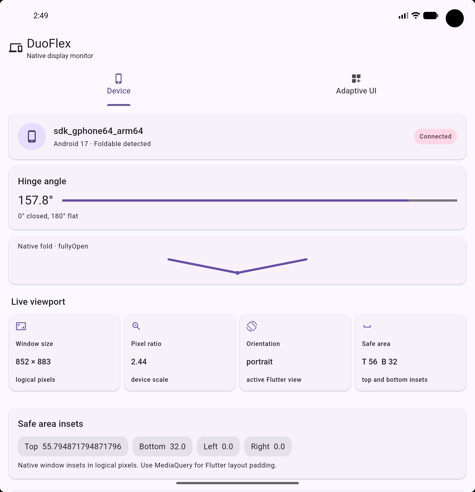

# duo_flex

`duo_flex` is a Flutter plugin for reading application-window geometry,
display regions, and fold data exposed by public platform APIs. Its adaptive
widgets use Flutter constraints and work on ordinary phones and other Flutter
platforms. Unsupported native fold data stays unknown or unavailable; the
plugin never infers hardware state from a device name, screen size, or angle.

## Install

Add `duo_flex` to your app:

```shell
flutter pub add duo_flex
```

The native implementations target iOS 15 and Android API 23 and later. Window
and device information work on ordinary phones. Android fold posture and hinge
bounds are reported when AndroidX Window detects a folding feature on Android
10 or later. Android hinge angle is read separately from
`Sensor.TYPE_HINGE_ANGLE` on Android 11 and later when the device exposes it.
On iOS, native hinge angle, posture, and reserved division regions require iOS
27.1 or later and a Flutter view for which UIKit reports those features. The adaptive
Flutter widgets work on any supported Flutter platform.

The package requires Dart 3.13.2 and Flutter 3.47.2 or later.

## Example

The example app shows native device and hinge readings alongside viewport and
safe-area data on iOS and Android:

| iOS | Android |
| --- | --- |
|  |  |

```dart
import 'package:duo_flex/duo_flex.dart';

Future<void> readDisplay() async {
  final capabilities = await DuoFlex.getCapabilities();
  final screen = await DuoFlex.getScreenInfo();
  if (screen != null) {
    print('Window: ${screen.width} × ${screen.height} logical pixels');
  }
  if (capabilities.supportsHingeAngle) {
    print(await DuoFlex.getHingeAngle());
  }
}
```

On iOS, device values come from `UIDevice`; on Android, they come from Android
system properties. Window dimensions, scale,
orientation, and safe-area insets come from the Flutter view and its attached
window. Measurements use UIKit points, which correspond to Flutter logical
pixels. The display snapshot reports physical screen bounds separately from
the application-window region. On iOS 27.1 and later, it also includes active
UIKit division and occlusion regions when the Flutter view overlaps them.
Flutter's
`MediaQuery` may already provide the safe-area values needed by widget layout.

Screen and display streams are broadcast and subscribe lazily. Screen events
begin with the current valid window snapshot, then report meaningful bounds,
scale, orientation, and safe-area changes. If the Flutter view is temporarily
detached, the stream waits for it to reattach and emits a fresh snapshot.
Display-change events are full snapshots of the display associated with the
Flutter view, including its active state and current regions; they are not
individual connection/disconnection records for unrelated external displays.
Observers pause while the associated scene is inactive and resume with a fresh
snapshot. When the active
Flutter view does not receive a hinge from UIKit, hinge angle is `null`, fold
posture is `unknown`, and both fold capabilities are false. On iOS
versions before 27.1, and on supported versions when the view has no hinge,
hinge and posture streams report an `UNSUPPORTED_FEATURE` stream error and
point-in-time calls return the safe nullable/unknown values.
Malformed events, missing plugin registration, and operational failures remain
errors. Multiple Dart listeners share the cached broadcast event stream.

## Apple API availability

The implementation is compiled against the installed public iOS 27.1 SDK and
uses runtime availability checks. Apple documents `UIHingeInteraction` and
`UIHinge` for observing hinge updates from a view hierarchy. `UIHinge.angle` is
in **radians**; the plugin preserves that unit. `UIHinge.Status` provides
`closed`, `partiallyOpen`, `fullyOpen`, and `unknown`. UIKit does not provide
separate `halfOpen`, `tabletop`, or `tent` status values, so those postures are
not inferred.

| Feature | Public API and minimum iOS | Status in this plugin |
| --- | --- | --- |
| Foldable identification | No device-wide foldability query; `UIHingeInteraction` is view-hierarchy based (iOS 27.1+) | Partial: `true` only after UIKit reports a hinge; otherwise `null` |
| Hinge angle | UIKit `UIHingeInteraction` / `UIHinge.angle` (iOS 27.1+) | Supported when UIKit supplies a hinge; radians, no range conversion |
| Fold posture | `UIHinge.Status` (iOS 27.1+) | Partial: closed, partially open, fully open; other states are unknown |
| Folded / unfolded configuration | `UIHinge.Status` (iOS 27.1+) | Partial: reports closed / partial / fully open hinge status, not a broader device pose |
| Tabletop / tent | No dedicated status in `UIHinge.Status` | Unsupported; not inferred from angle or orientation |
| Physical hinge exclusion region | `UIView.reservedRegions(kind: .division)` (iOS 27.1+) | Partial: reports real UIKit division geometry as `reservedDivision` |
| Other reserved regions | `UIView.reservedRegions(kind: .occlusion)` (iOS 27.1+) | Partial: reports real occlusion geometry as `reservedOcclusion` |
| Fold configuration changes | `UIHingeInteraction` updates (iOS 27.1+) | Supported while fold streams are subscribed; refreshes display snapshots |
| Camera-side identification | Reserved occlusion regions expose geometry and opaque IDs, not a stable camera-side identity | Unsupported |
| Main / secondary fold displays | UIKit scenes and displays exist, but this plugin does not identify foldable panel roles | Unsupported |
| Display geometry | `UIWindow` / `UIScreen` associated with the Flutter view | Supported; physical screen snapshot is separate from the app window |
| Window resize / display changes | UIKit view geometry and scene/display notifications | Supported for app-window and reported display snapshots |

Apple's public documentation describes [hinge updates](https://developer.apple.com/documentation/uikit/uihingeinteraction), the [hinge angle in radians](https://developer.apple.com/documentation/uikit/uihinge/angle), [hinge statuses](https://developer.apple.com/documentation/uikit/uihinge/status-swift.enum), and [reserved view regions](https://developer.apple.com/documentation/uikit/uiviewreservedregion). Apple's [UIKit iPhone Duo Tech Talk](https://developer.apple.com/videos/play/tech-talks/111464/) distinguishes hinge data from layout APIs and documents the supported high-level states. The installed iOS SDK headers declare these hinge and reserved-region APIs as available starting in iOS 27.1. Reserved-region identifiers are passed through as native opaque strings and should not be treated as persistent identifiers.

Reserved-region rectangles use the Flutter view's UIKit point coordinate space. The IDs are native opaque values and are not promised to persist across launches or layout changes.

Fold hardware state stays separate from responsive layout state. A wide or narrow Flutter window does not prove that a device is unfolded or folded. Use Flutter `LayoutBuilder` or `MediaQuery` for layout adaptation; the hinge APIs describe physical hardware only when UIKit supplies a hinge.

## Adaptive Flutter widgets

`DuoAdaptiveLayout` and `DuoScreenBuilder` use Flutter's local constraints and
work on ordinary phones and all Flutter platforms. The default width thresholds
are 600 logical pixels for medium and 840 for expanded; customize them for the
needs of your app. They classify available layout width and never identify
physical fold posture.

```dart
DuoAdaptiveLayout(
  compact: const CompactHomePage(),
  medium: const MediumHomePage(),
  expanded: const ExpandedHomePage(),
  breakpoints: const DuoLayoutBreakpoints(medium: 560, expanded: 900),
)
```

For a single widget that depends on the current responsive category:

```dart
DuoAdaptiveLayout.builder(
  builder: (context, layout) => Text(
    '${layout.size.name}: ${layout.width} × ${layout.height}',
  ),
)
```

When width is unbounded, `DuoAdaptiveLayout` uses the nearest Flutter view
width. This makes it usable inside horizontally unbounded scrollable parents;
for layouts that need to classify a narrower region, put it inside a widget
that provides bounded width constraints. Unbounded height uses the nearest
Flutter view height for orientation metadata. `DuoLayoutInfo` dimensions are
local logical pixels; they are not physical display measurements.
`DuoScreenBuilder` uses local finite constraints and falls back to the nearest
`MediaQuery` view size for an unbounded axis.

`DuoScreenBuilder` reports constrained local viewport dimensions and current
Flutter `MediaQuery` values without starting native event subscriptions:

```dart
DuoScreenBuilder(
  builder: (context, screen) => Text(
    'Viewport: ${screen.width} × ${screen.height}; '
    'orientation: ${screen.orientation.name}',
  ),
)
```

Its `viewPadding` describes system intrusions, `padding` is the currently
available safe padding, and `viewInsets` describes fully obscured areas such as
the keyboard. Keyboard insets are kept separate from safe areas. Flutter has
already applied its own safe-area adjustments; do not add the native
`DuoScreenInfo.safeArea` on top of `MediaQuery.padding`. Neither API fabricates
hinge geometry.

`DuoFoldBuilder` checks `DuoCapabilities` once when mounted and subscribes only
to supported hinge and posture streams. It preserves a missing hinge angle as
`null`, and missing posture as `DuoFoldPosture.unknown`. Loading, unsupported,
and error UI can be customized with `loadingBuilder`, `unsupportedBuilder`,
and `errorBuilder`.

```dart
DuoFoldBuilder(
  builder: (context, foldState, capabilities) {
    if (!capabilities.supportsFoldPosture) {
      return const Text('Physical posture unavailable');
    }
    return Text('Native posture: ${foldState.posture.name}');
  },
)
```

`DuoFoldAwareLayout` selects a supplied child only for a posture actually
reported by the platform. Unknown posture, unsupported hardware, errors, or an
omitted posture-specific child use `defaultLayout`. Responsive selection stays
independent and can be composed as its default:

```dart
DuoFoldAwareLayout(
  defaultLayout: DuoAdaptiveLayout(
    compact: const CompactHomePage(),
    medium: const MediumHomePage(),
    expanded: const ExpandedHomePage(),
  ),
  fullyOpenLayout: const FullyOpenHomePage(),
)
```

The iOS implementation currently reports `closed`, `partiallyOpen`, and
`fullyOpen` from UIKit when a hinge is supplied. It does not report tabletop or
tent postures, so those optional layouts are not selected on iOS. Without
verified native posture, the default responsive layout remains active. All
fold subscriptions are cancelled when their widgets are disposed.

The example app's **Device** tab shows native device, display, safe-area, and
capability information. The **Adaptive UI** tab demonstrates local viewport
breakpoints and native fold-aware widget selection. The example displays native
readings only; unsupported or unavailable values are shown explicitly instead
of being replaced with simulated hardware data.

## Platform support

| Platform | Native display and fold API | Adaptive widgets |
| --- | --- | --- |
| iOS 15+ | Device and window data; fold features only when public UIKit APIs report them (iOS 27.1+) | Supported |
| Android API 23+ | Device and window data; folding feature bounds and flat / half-open state on Android 10+ when AndroidX Window reports them; hinge angle on Android 11+ when the device exposes the sensor | Supported |
| Other Flutter platforms | Native data API is unsupported unless an implementation is registered | Supported |

Android fold data is limited to the bounds and state exposed by AndroidX
Window. Android reports `tabletop` for a horizontal half-open feature and
`book` for a vertical half-open feature. Hinge angle comes from the separate
Android hinge-angle sensor; the event stream filters changes below 0.3° and
converts sensor degrees to radians. A missing sensor or readings leaves the
angle unavailable. A missing folding feature means Android has not reported
fold geometry; it does not establish that the device is not foldable. Some
device or OS failures may prevent Android from delivering fold state. Use the
layout widgets for responsive UI on other platforms; native methods return an
unsupported error where a platform implementation is not available.

## License

This package is available under the [MIT License](LICENSE).
